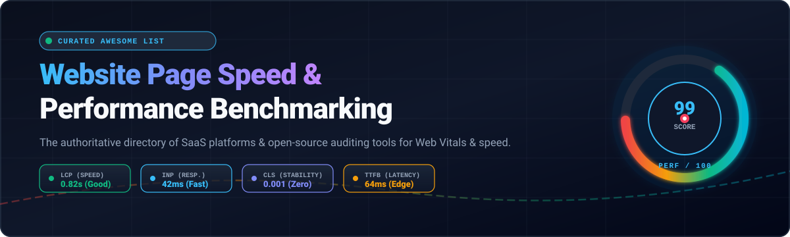

  

# Awesome Website Page Speed & Performance Benchmarking

> An authoritative, SEO-optimized, and curated directory of top **Website Page Speed**, **Core Web Vitals (LCP, INP, CLS)**, and **Performance Benchmarking** platforms — featuring enterprise SaaS solutions, competitive intelligence tools, and top-starred open-source performance auditing frameworks.

---

## 📑 Table of Contents

- [📈 Sector Overview & Market Dynamics](#-sector-overview--market-dynamics)
- [🟦 SaaS / Hosted Platforms](#-saas--hosted-platforms)
  - [SaaS Solutions Comparison & Pricing Table](#saas-solutions-comparison--pricing-table)
  - [Detailed SaaS Platform Deep Dives](#detailed-saas-platform-deep-dives)
- [🟩 Open-Source Software](#-open-source-software)
  - [Top Open-Source Tools Ranked by GitHub Stars](#top-open-source-tools-ranked-by-github-stars)
  - [Detailed Open-Source Tool Descriptions](#detailed-open-source-tool-descriptions)
- [📊 Feature Comparison at a Glance](#-feature-comparison-at-a-glance)
- [🔍 SEO & Performance Optimization Checklist](#-seo--performance-optimization-checklist)
- [🤝 Contributing](#-contributing)
- [📄 License](#-license)

---

## 📈 Sector Overview & Market Dynamics

The global web performance monitoring and digital experience monitoring (DEM) market is valued at approximately **$6.5B to $7.2B in 2025–2026** and is expanding at a 10–12% CAGR, propelled by search engine algorithmic enforcement of Core Web Vitals (LCP, INP, CLS) and direct revenue correlation in digital commerce. 

From a market structure perspective, the industry exhibits a **moderately concentrated enterprise tier** alongside a **highly fragmented SMB and point-solution tier**: while enterprise spend is dominated by consolidated observability platforms and hyperscaler ecosystems, the page speed and synthetic testing landscape remains broadly competitive with agile point solutions, developer-first startups, and self-hosted open-source instrumentation.

---

## 🟦 SaaS / Hosted Platforms

Commercial, cloud-hosted Website Page Speed and Performance Benchmarking platforms. Sorted by estimated company size (market valuation or parent annual revenue) in descending order.

### SaaS Solutions Comparison & Pricing Table

| Platform | Parent / Company Size (Valuation / Revenue) | Starting Tier Pricing | Free Tier Limit / Free Trial Limit | Core Focus |
|:---|:---|:---|:---|:---|
| **[Google PageSpeed Insights](https://pagespeed.web.dev/)** | **Alphabet (~$2.1T+ Market Cap / ~$350B+ Rev)** | **Free ($0)** | **100% Free Forever** (25,000 queries/day via PSI API, unlimited web UI audits) | Lab audits (Lighthouse) + Real-world Chrome User Experience Report (CrUX) |
| **[Contentsquare Speed Analysis (Dareboost)](https://contentsquare.com/)** | **~$5.6B Valuation (~$350M+ ARR)** | **Custom / ~€29–$68/mo (Historical Starter)** | **5 website analyses per month** (free email signup; advanced monitoring features excluded) | User experience testing, configurable browser environments & filmstrips |
| **[BrowserStack SpeedLab](https://www.browserstack.com/speedlab)** | **~$4.0B Valuation (~$230M ARR)** | **$29/mo** (Desktop Live, billed annually) / **$39/mo** (monthly) | **30 minutes total testing time** (approx. 1 min per device/browser session) | Real-hardware mobile & desktop device speed audits & QA diagnostics |
| **[Pingdom (SolarWinds)](https://www.pingdom.com/)** | **~$3.2B Valuation (~$780M ARR)** | **$10/mo to $18/mo** (Synthetic: 10 uptime checks, 1 advanced check, 50 SMS alerts) | **30-day full-featured free trial** (unlimited trial checks; no permanent free tier) | Global synthetic uptime monitoring, transaction simulation & waterfall charts |
| **[WebPageTest (Catchpoint)](https://www.webpagetest.org/)** | **~$250M+ Acquisition (~$45M–$60M ARR)** | **$18.75/mo** (Pro Monthly) / **$15/mo** ($180/yr billed annually) | **300 test runs per month** (Starter Free Plan: filmstrips, videos & 30 locations) | Deep low-level browser diagnostics, no-code experiments & custom scripting |
| **[GTmetrix](https://gtmetrix.com/)** | **Carbon60 (~$15M–$45M Parent Revenue)** | **$5/mo** (Micro Plan) / **$14.50/mo** (Solo Plan) | **5 on-demand tests per month** + 1 daily/weekly monitored slot (reports kept 1 week) | Lighthouse reports, waterfall analysis, worldwide testing & MCP AI integration |
| **[Uptrends Speed Test](https://www.uptrends.com/tools/website-speed-test)** | **~$5M–$15M Rev (Parent Uptime Holding)** | **$42/mo** (Core Plan, billed annually) / **$46/mo** (monthly) | **30-day free trial** (enterprise access, no credit card required; free public web test) | Multi-checkpoint synthetic browser rendering & impact-prioritized audits |
| **[SpeedCurve](https://www.speedcurve.com/)** | **Acquired by Embrace (~$5M–$10M Est. ARR)** | **$90/mo** (Starter Plan) / **$576/mo** (Growth Plan) | **30-day free trial** (capped synthetic checks, max 1,000 API requests/day) | Continuous RUM + synthetic tracking & side-by-side competitive benchmarking |
| **[Calibre](https://calibreapp.com/)** | **Bootstrapped B2B SaaS (~$1M–$3M Est. ARR)** | **$75/mo** (Starter Plan, 5K RUM sessions + 5K synthetic tests, 3 seats) | **15-day free trial** (full platform access, no credit card required) | Developer-centric performance CLI/API, CrUX tracking & automated budgets |
| **[DebugBear](https://www.debugbear.com/)** | **Seed-backed (~$350K+ ARR, TinySeed)** | **$125/mo** (Startup Plan, synthetic monitoring for 1 primary project) | **14-day free trial** (no credit card required; includes synthetic & RUM trials) | Deep Core Web Vitals monitoring, Server-Timing headers & frontend waterfalls |

---

### Detailed SaaS Platform Deep Dives

#### BrowserStack SpeedLab
- **Company Scale:** ~$4.0B Valuation (~$230M ARR)
- **Starting Price:** $29/month (Live Desktop plan)
- **Free Limit:** 30 minutes total testing time
- **Overview:** Evaluates website speed on genuine mobile devices and desktop hardware rather than emulators. Reports provide real-world TTFB, response timings, load durations, and field Core Web Vitals across iOS, Android, macOS, and Windows.
- **Best For:** Enterprise QA teams needing hardware-level verification across real-world carrier and operating system setups.

#### Google PageSpeed Insights
- **Company Scale:** Alphabet ($2.1T+ Market Cap)
- **Starting Price:** $0 (Free)
- **Free Limit:** 100% Free Forever (25,000 API queries/day)
- **Overview:** The industry standard for search rankings. Blends Lighthouse lab audits with Chrome User Experience Report (CrUX) field data representing real Chrome users worldwide over 28-day rolling periods.
- **Best For:** Webmasters, SEO specialists, and technical leads auditing Core Web Vitals against Google ranking criteria.

#### GTmetrix
- **Company Scale:** Carbon60 (~$15M–$45M Parent Revenue)
- **Starting Price:** $5/month (Micro Plan) / $14.50/month (Solo Plan)
- **Free Limit:** 5 on-demand tests/month, 1 monitored slot, 1-week report retention
- **Overview:** Combines Lighthouse audits with custom waterfall visualizations, video playback, and scheduled tracking across 28 global test regions and 55+ simulated devices. Includes Model Context Protocol (MCP) tooling for AI-driven dev agents.
- **Best For:** Developers wanting actionable audits, scheduled monitoring, and AI workflow integrations.

#### WebPageTest (Catchpoint)
- **Company Scale:** ~$250M+ Acquisition (~$45M–$60M ARR)
- **Starting Price:** $15/month ($180 billed annually) / $18.75/month
- **Free Limit:** 300 test runs per month across ~30 locations
- **Overview:** The gold standard for deep diagnostic testing. Delivers frame-by-frame filmstrips, connection waterfalls, single-point-of-failure (SPOF) analysis, and no-code performance experiments (injecting scripts or blocking assets).
- **Best For:** Performance architects and diagnostic engineers analyzing bottlenecks down to TCP handshakes and packet transfers.

#### Pingdom Website Speed Test
- **Company Scale:** SolarWinds (~$3.2B Valuation / ~$780M ARR)
- **Starting Price:** $10 to $18/month (Synthetic monitoring slider)
- **Free Limit:** 30-day full-featured free trial
- **Overview:** Offers immediate page speed snapshots, asset weight breakdowns, and HTTP request distributions across global regions, backed by enterprise-grade uptime and transaction monitoring.
- **Best For:** Operations teams requiring unified synthetic uptime alerts and baseline web speed diagnostics.

#### SpeedCurve
- **Company Scale:** Acquired by Embrace (~$5M–$10M Est. ARR)
- **Starting Price:** $90/month (Starter tier)
- **Free Limit:** 30-day free trial (capped synthetic checks, 1,000 API requests/day)
- **Overview:** Built by pioneers in web performance, SpeedCurve pairs synthetic monitoring with RUM. Its standout capability is side-by-side competitive benchmarking, letting teams visualize filmstrips against industry competitors.
- **Best For:** Product teams needing continuous performance monitoring paired with competitive performance tracking.

#### DebugBear
- **Company Scale:** Early-stage SaaS (~$350K+ ARR)
- **Starting Price:** $125/month (Startup tier)
- **Free Limit:** 14-day free trial (no credit card required)
- **Overview:** Delivers continuous Core Web Vitals tracking with unique Server-Timing header integration, letting developers inspect backend processing timings directly inside browser waterfall graphs.
- **Best For:** Engineering teams demanding integrated backend-to-frontend visibility and automated performance regression alerts.

#### Calibre
- **Company Scale:** Bootstrapped B2B SaaS (~$1M–$3M ARR)
- **Starting Price:** $75/month (Starter tier, includes 5K synthetic tests & 5K RUM sessions)
- **Free Limit:** 15-day free trial (no credit card required)
- **Overview:** Developer-centric platform offering a rich Node.js CLI and GraphQL API. Automates performance budgets in CI/CD, extracts CrUX data, and outputs clean JSON for automation scripts and AI coding agents.
- **Best For:** Modern software teams embedding automated performance budgets and CrUX metrics into CI/CD workflows.

#### Contentsquare Speed Analysis (formerly Dareboost)
- **Company Scale:** Contentsquare (~$5.6B Valuation / ~$350M+ ARR)
- **Starting Price:** Custom / ~€29–$68/month (historical baseline)
- **Free Limit:** 5 analysis reports per month
- **Overview:** Detailed desktop and mobile browser testing with configurable conditions (HTTP headers, bandwidth limits, ad blockers). Generates Speed Index, Visually Complete, and technical recommendations.
- **Best For:** Digital marketers and eCommerce managers looking to correlate web speed directly with UX metrics.

#### Uptrends Speed Test
- **Company Scale:** Parent Uptime Holding (~$5M–$15M Revenue)
- **Starting Price:** $42/month (Core plan billed annually)
- **Free Limit:** 30-day free trial (full Enterprise capabilities)
- **Overview:** Cloud-based synthetic checks executed through real Google Chrome and Microsoft Edge browsers across 230+ worldwide checkpoints. Offers prioritized recommendations for speed improvements.
- **Best For:** Mid-market organizations wanting multi-browser synthetic benchmarking with worldwide geographic distribution.

---

## 🟩 Open-Source Software

Community-driven, self-hosted web performance auditing, synthetic benchmarking, and Core Web Vitals monitoring libraries.

### Top Open-Source Tools Ranked by GitHub Stars

| Repository | GitHub Stars Badge | Stack / Runtime | License | Core Focus |
|:---|:---|:---|:---|:---|
| **[Lighthouse](https://github.com/GoogleChrome/lighthouse)** |  | Node.js / Chrome DevTools | Apache-2.0 | Automated auditing engine for Performance, SEO, Accessibility & PWA |
| **[Quicklink](https://github.com/GoogleChromeLabs/quicklink)** |  | JavaScript (Browser) | Apache-2.0 | High-speed page navigation via link prefetching during browser idle time |
| **[web-vitals](https://github.com/GoogleChrome/web-vitals)** |  | TypeScript / JavaScript | Apache-2.0 | Tiny, modular library for accurately capturing real-user Core Web Vitals |
| **[Lighthouse CI](https://github.com/GoogleChrome/lighthouse-ci)** |  | Node.js / CLI | Apache-2.0 | CI/CD automated regression gatekeeper and performance budget enforcement |
| **[sitespeed.io](https://github.com/sitespeedio/sitespeed.io)** |  | Node.js / Docker | MIT | Complete self-hosted benchmarking suite with Grafana / InfluxDB integration |
| **[Perfume.js](https://github.com/Zizzamia/perfume.js)** |  | TypeScript / Browser | MIT | Client-side performance monitoring library for Web Vitals & custom metrics |
| **[psi (PageSpeed Insights Node)](https://github.com/GoogleChromeLabs/psi)** |  | Node.js / CLI | Apache-2.0 | Programmatic PageSpeed Insights API runner directly from terminal & build scripts |
| **[Web Vitals Extension](https://github.com/GoogleChrome/web-vitals-extension)** |  | JavaScript (Chrome Ext) | Apache-2.0 | Real-time visual overlay measuring Core Web Vitals on desktop Chrome |
| **[phantomas](https://github.com/macbre/phantomas)** |  | Node.js / Chromium | BSD-2-Clause | Headless performance metrics collector tracking asset bloat, repaints & DOM queries |
| **[Lighthouse CI Action](https://github.com/treosh/lighthouse-ci-action)** |  | GitHub Action / Node | MIT | GitHub Action for running Lighthouse audits and failing pull requests on regressions |
| **[Browsertime](https://github.com/sitespeedio/browsertime)** |  | Node.js / WebDriver | Apache-2.0 | Browser harness recording video, filmstrips, HAR files & performance metrics |

---

### Detailed Open-Source Tool Descriptions

#### 1. [Lighthouse](https://github.com/GoogleChrome/lighthouse)
- **Stars:** 
- **Stack:** Node.js / Chromium | **License:** Apache-2.0
- **Summary:** The foundational open-source audit engine that powers Google DevTools, PageSpeed Insights, and GTmetrix. Collects lab metrics across Largest Contentful Paint (LCP), Total Blocking Time (TBT), Cumulative Layout Shift (CLS), and provides prioritized optimization diagnostics.

#### 2. [Quicklink](https://github.com/GoogleChromeLabs/quicklink)
- **Stars:** 
- **Stack:** JavaScript (Browser) | **License:** Apache-2.0
- **Summary:** Accelerates subsequent page transitions by automatically prefetching in-viewport links during idle browser cycles. Monitors link visibility with `IntersectionObserver` and uses `navigator.connection` to respect user data saver settings.

#### 3. [web-vitals](https://github.com/GoogleChrome/web-vitals)
- **Stars:** 
- **Stack:** TypeScript / JavaScript | **License:** Apache-2.0
- **Summary:** The official, lightweight (1-2 KB) library from Google designed to capture all Web Vitals metrics on real users in a manner that accurately matches how they are measured by Chrome and reported to CrUX.

#### 4. [Lighthouse CI](https://github.com/GoogleChrome/lighthouse-ci)
- **Stars:** 
- **Stack:** Node.js | **License:** Apache-2.0
- **Summary:** A comprehensive test harness designed to automate Lighthouse audits across every commit and Pull Request. Enforces strict assertion budgets, posts summary comments on GitHub PRs, and hosts historical test trends.

#### 5. [sitespeed.io](https://github.com/sitespeedio/sitespeed.io)
- **Stars:** 
- **Stack:** Node.js / Docker | **License:** MIT
- **Summary:** An all-in-one open-source performance monitoring platform. Runs real browser tests via Browsertime, combines Coach recommendations with Lighthouse audits, and streams data into Graphite/InfluxDB for customized Grafana dashboards.

#### 6. [Perfume.js](https://github.com/Zizzamia/perfume.js)
- **Stars:** 
- **Stack:** TypeScript | **License:** MIT
- **Summary:** A modular web performance monitoring library that calculates modern performance metrics (FCP, LCP, INP, CLS, TTFB) alongside custom user-centric performance marks, piping results into Google Analytics or custom telemetry endpoints.

#### 7. [psi (PageSpeed Insights for Node)](https://github.com/GoogleChromeLabs/psi)
- **Stars:** 
- **Stack:** Node.js | **License:** Apache-2.0
- **Summary:** Run Google PageSpeed Insights directly from your CLI or Node.js scripts. Formats comprehensive terminal reports, provides threshold checks, and generates sharable URLs without requiring browser navigation.

#### 8. [Web Vitals Chrome Extension](https://github.com/GoogleChrome/web-vitals-extension)
- **Stars:** 
- **Stack:** JavaScript | **License:** Apache-2.0
- **Summary:** Chrome extension providing real-time visual feedback on Core Web Vitals for any web page as you browse, highlighting exact culprit elements responsible for layout shifts or long interaction latencies.

#### 9. [phantomas](https://github.com/macbre/phantomas)
- **Stars:** 
- **Stack:** Node.js / Chromium | **License:** BSD-2-Clause
- **Summary:** High-precision command-line performance metrics collector. Analyzes over 100 performance indicators including DOM operations, duplicate CSS rules, jQuery event bindings, uncached static assets, and repaint counts.

#### 10. [Lighthouse CI Action](https://github.com/treosh/lighthouse-ci-action)
- **Stars:** 
- **Stack:** GitHub Actions / Node.js | **License:** MIT
- **Summary:** Zero-configuration GitHub Action wrapper around Lighthouse CI that executes automated audits against pull requests, asserts minimum scores, and blocks builds with failing performance budgets.

#### 11. [Browsertime](https://github.com/sitespeedio/browsertime)
- **Stars:** 
- **Stack:** Node.js / Selenium WebDriver | **License:** Apache-2.0
- **Summary:** Low-level browser automation engine that drives Chrome, Firefox, or Safari, records video at 60fps, calculates visual metrics (Speed Index, Perceptual Speed Index), and generates detailed HAR records.

---

## 📊 Feature Comparison at a Glance

| Software / Solution | License | Deployment Type | Core Web Vitals | RUM / Field Data | CI/CD Automation | Best For |
|:---|:---|:---|:---:|:---:|:---:|:---|
| **Google PageSpeed Insights** | Proprietary | SaaS | ✅ | ✅ (CrUX) | ❌ | SEO ranking verification |
| **GTmetrix** | Proprietary | SaaS | ✅ | ✅ (CrUX) | ⚠️ (API) | Monitoring & AI workflows |
| **BrowserStack SpeedLab** | Proprietary | SaaS | ✅ | ❌ | ⚠️ (API) | Real mobile/desktop hardware QA |
| **WebPageTest (Catchpoint)** | Proprietary | SaaS | ✅ | ✅ (RUM) | ⚠️ (API) | Deep diagnostics & script testing |
| **Pingdom (SolarWinds)** | Proprietary | SaaS | ⚠️ | ❌ | ⚠️ (API) | Quick uptime & waterfall alerts |
| **SpeedCurve** | Proprietary | SaaS | ✅ | ✅ (RUM) | ⚠️ (API) | Competitive benchmarking |
| **DebugBear** | Proprietary | SaaS | ✅ | ✅ (RUM) | ⚠️ (API) | Server-Timing & CWV alerts |
| **Calibre** | Proprietary | SaaS | ✅ | ✅ (CrUX/RUM) | ✅ (CLI/API) | Automated PR performance budgets |
| **Lighthouse** | Apache-2.0 | CLI / Node | ✅ | ❌ | ✅ | Standard Google audit engine |
| **Quicklink** | Apache-2.0 | Client Script | ❌ | ❌ | ❌ | Instant subsequent navigations |
| **web-vitals** | Apache-2.0 | Client Script | ✅ | ✅ (RUM) | ❌ | Telemetry instrumentation |
| **Lighthouse CI** | Apache-2.0 | Self-Hosted / CI | ✅ | ❌ | ✅ | Automated PR regression blocking |
| **sitespeed.io** | MIT | Self-Hosted / Docker | ✅ | ❌ | ✅ | Enterprise self-hosted dashboards |
| **Perfume.js** | MIT | Client Script | ✅ | ✅ (RUM) | ❌ | Real-user performance telemetry |
| **Browsertime** | Apache-2.0 | Self-Hosted | ✅ | ❌ | ✅ | Headless video & HAR pipelines |

---

## 🔍 SEO & Performance Optimization Checklist

When benchmarking and optimizing websites for maximum organic reach and Core Web Vitals compliance, focus on:

1. **Largest Contentful Paint (LCP) < 2.5s**
   - Ensure hero image preloading via `<link rel="preload" as="image" ... fetchpriority="high">`.
   - Implement modern image formats (AVIF / WebP) with responsive `srcset` directives.
   - Utilize a global CDN with Edge TTFB < 200ms and HTTP/3 support.
2. **Interaction to Next Paint (INP) < 200ms**
   - Break up long JavaScript tasks (> 50ms) using `scheduler.yield()` or `requestIdleCallback()`.
   - Offload heavy compute tasks to Web Workers.
   - Avoid deep DOM updates inside synchronous input event listeners.
3. **Cumulative Layout Shift (CLS) < 0.1**
   - Always include explicit `width` and `height` attributes on `` and `<video>` tags.
   - Reserve container slots for dynamic advertising and banner widgets using CSS `min-height` or `aspect-ratio`.
   - Use `font-display: swap` combined with font metric overrides (`size-adjust`) to avoid layout jumps.

---

## 🤝 Contributing

Contributions are welcome! If you know of an outstanding open-source tool, benchmarking utility, or performance monitoring framework that should be included:

1. Fork this repository.
2. Create your feature branch (`git checkout -b feature/suggested-tool`).
3. Add the project to the relevant section with its stack, license, GitHub badge, and key features.
4. Commit your changes and open a Pull Request.

---

## 📄 License

This repository and curated list are released under the [Creative Commons Zero v1.0 Universal](LICENSE) (CC0 1.0 - Public Domain Dedication). Listed software products, logos, and trademarks retain the property of their respective copyright holders.

---

  <b>⭐ If this benchmark resource assisted your optimization journey, consider starring this repository! ⭐</b>

